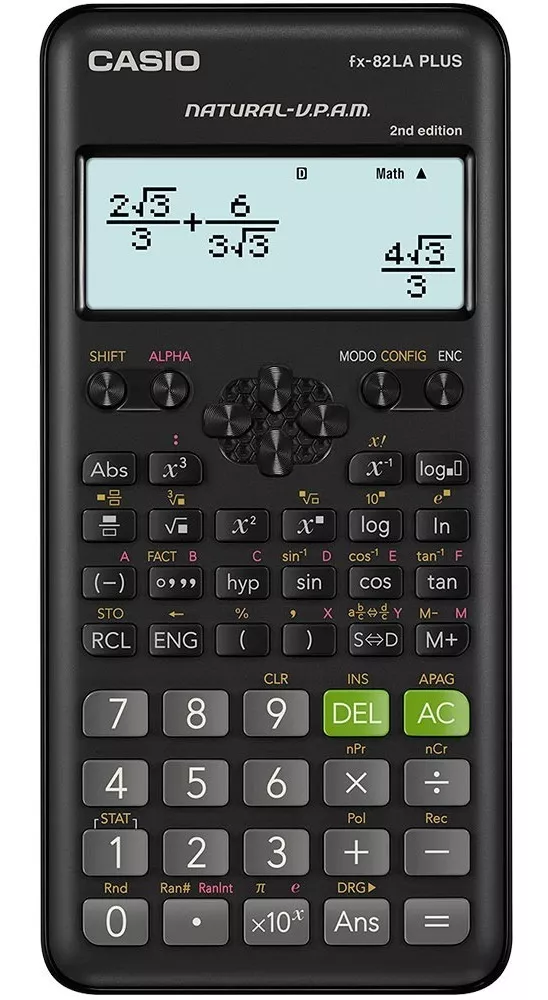
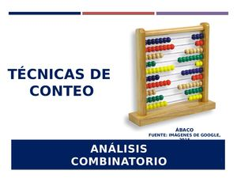

```{=html}
<div style="position:absolute; top:10px; right:10px;">

</div>
```

```{=html}
<style>
body{
  background-color:#f7f6ed;
  font-size:130%;
  text-align:justify;
}
</style>
```

# .Cargar paquetes

```{r}
ipak <- function(pkg){

  options(repos = c(CRAN="https://cloud.r-project.org"))

  new.pkg <- pkg[!(pkg %in% rownames(installed.packages()))]

  if(length(new.pkg)) install.packages(new.pkg, dependencies = TRUE)

  invisible(lapply(pkg, function(p)
    suppressPackageStartupMessages(library(p, character.only = TRUE))
  ))
}

packages <- c("tidyverse","kableExtra","gtools","readxl")

ipak(packages)
```

# .Presentación

Las **técnicas de conteo** permiten determinar cuántos resultados, arreglos, selecciones o decisiones pueden realizarse sin tener que enumerarlos uno por uno. Constituyen una herramienta fundamental para calcular probabilidades, organizar información, diseñar experimentos y resolver problemas de administración, economía, educación, informática y ciencias del deporte.

Este material toma como referencia la clasificación y las fórmulas del documento *Fórmulas de combinatoria* suministrado: variaciones, variaciones con repetición, permutaciones, permutaciones con repetición, combinaciones, combinaciones con repetición y relaciones notables. Se amplía el contenido con el **principio multiplicativo**, su representación mediante diagramas de árbol y ejemplos desarrollados con R.

::: callout-tip
## Tres preguntas antes de contar

1.  **¿El proceso ocurre en etapas?** Si es así, puede ser útil el principio multiplicativo y un diagrama de árbol.
2.  **¿Importa el orden?** Si cambiar el orden produce un resultado diferente, se consideran variaciones o permutaciones.
3.  **¿Se permite repetir?** La respuesta determina cuál fórmula corresponde.
:::

# .Conceptos preliminares

**Experimento y resultado**

Un experimento de conteo es un procedimiento que puede producir distintos resultados. Por ejemplo, elegir una persona para representar un grupo, asignar cargos, construir una contraseña o seleccionar integrantes de un comité.

Un **resultado** es cada posibilidad concreta del procedimiento. Si se elige una camisa y un pantalón, un resultado puede ser (camisa azul, pantalón negro).

**Factorial**

Para un entero no negativo $n$, el factorial de $n$ es el producto de los enteros positivos desde 1 hasta $n$. Por definición, $0!=1$.

$$
n!=n(n-1)(n-2)\cdots 2\cdot 1,\qquad 0!=1.
$$

Ejemplo:

$$
5!=5\cdot4\cdot3\cdot2\cdot1=120.
$$

En R se calcula mediante `factorial()`:

```{r}
factorial(5)
factorial(0)
```

**Notación utilizada**

En este documento:

- $m$: número total de elementos u opciones disponibles.
- $n$: número de elementos seleccionados o posiciones que deben ocuparse.
- $n_1,n_2,\ldots,n_k$: cantidades de elementos repetidos de cada tipo.

Se supone que $0\leq n\leq m$ en variaciones y combinaciones sin repetición.

# .Técnica de la multiplicación

**Definición**

El **principio multiplicativo** establece que si un procedimiento se realiza en varias etapas y:

- la primera etapa puede realizarse de $n_1$ maneras;
- la segunda etapa puede realizarse de $n_2$ maneras por cada resultado de la primera;
- la tercera etapa puede realizarse de $n_3$ maneras por cada resultado de las dos primeras;
- y así sucesivamente,

entonces el número total de resultados posibles es:

$$
N=n_1\cdot n_2\cdot n_3\cdots n_k
=\prod_{i=1}^{k}n_i.
$$

La multiplicación se aplica cuando cada resultado final se construye tomando una opción de cada etapa. El número de opciones de una etapa puede depender de las elecciones anteriores; en ese caso se deben contar las opciones disponibles en cada rama.

**Ejemplo 1: vestuario**

Una persona dispone de 3 camisas (blanca, azul y negra), 2 pantalones (gris y beige) y 2 pares de zapatos (negros y cafés). ¿Cuántos atuendos diferentes puede formar si elige una prenda de cada tipo?

**Solución.** El proceso tiene tres etapas:

- Camisa: 3 opciones.
- Pantalón: 2 opciones.
- Zapatos: 2 opciones.

Por el principio multiplicativo:

$$
N=3\cdot2\cdot2=12.
$$

En R:

```{r}
camisas <- c("Blanca", "Azul", "Negra")
pantalones <- c("Gris", "Beige")
zapatos <- c("Negros", "Cafés")

total_atUendos <- length(camisas) *
  length(pantalones) * length(zapatos)

total_atUendos
```

Podemos generar las 12 posibilidades con `expand.grid()`:

```{r}
atuendos <- expand.grid(
  Camisa = camisas,
  Pantalon = pantalones,
  Zapatos = zapatos
)

atuendos
nrow(atuendos)
```

**Diagrama de árbol**

Un **diagrama de árbol** representa gráficamente las decisiones sucesivas. Cada bifurcación corresponde a una opción y cada camino completo desde el inicio hasta una hoja representa un resultado posible.

Para el ejemplo del vestuario, el árbol puede representarse de forma esquemática así:

```{mermaid}
flowchart TD
    I["Inicio"] --> C1["Camisa blanca"]
    I --> C2["Camisa azul"]
    I --> C3["Camisa negra"]
    C1 --> P11["Pantalón gris"]
    C1 --> P12["Pantalón beige"]
    C2 --> P21["Pantalón gris"]
    C2 --> P22["Pantalón beige"]
    C3 --> P31["Pantalón gris"]
    C3 --> P32["Pantalón beige"]
    P11 --> Z111["Zapatos negros"]
    P11 --> Z112["Zapatos cafés"]
    P12 --> Z121["Zapatos negros"]
    P12 --> Z122["Zapatos cafés"]
    P21 --> Z211["Zapatos negros"]
    P21 --> Z212["Zapatos cafés"]
    P22 --> Z221["Zapatos negros"]
    P22 --> Z222["Zapatos cafés"]
    P31 --> Z311["Zapatos negros"]
    P31 --> Z312["Zapatos cafés"]
    P32 --> Z321["Zapatos negros"]
    P32 --> Z322["Zapatos cafés"]
```

Cada una de las 3 ramas iniciales se continúa con 2 alternativas de pantalón y cada una de estas con 2 alternativas de zapatos. Por tanto, el árbol tiene:

$$
3\cdot2\cdot2=12\text{ caminos completos}.
$$

::: callout-note
Un diagrama de árbol puede crecer rápidamente. Es especialmente útil para visualizar procesos con pocas etapas y pocas alternativas. Cuando hay muchas opciones, el principio multiplicativo permite contar sin dibujar todas las ramas.
:::

**Ejemplo 2: código de acceso**

Una institución diseña códigos de acceso de 4 dígitos. Cada posición puede contener cualquiera de los dígitos del 0 al 9 y se permite repetir. ¿Cuántos códigos pueden formarse?

Cada una de las cuatro posiciones tiene 10 opciones:

$$
N=10\cdot10\cdot10\cdot10=10^4=10\,000.
$$

```{r}
opciones_por_posicion <- rep(10, 4)
prod(opciones_por_posicion)
```

**Interpretación:** se cuentan códigos, por lo que se admiten códigos que comiencen por cero. Si el problema exigiera números de cuatro cifras, la primera posición tendría solo 9 opciones (del 1 al 9).

**Ejemplo 3: elecciones sin devolución**

En una urna hay 5 bolas distintas. Se extraen dos bolas consecutivamente, sin devolver la primera. ¿Cuántos pares ordenados de resultados pueden obtenerse?

- Primera extracción: 5 opciones.
- Segunda extracción: 4 opciones.

$$
N=5\cdot4=20.
$$

```{r}
5 * 4
```

El orden importa porque extraer primero la bola A y después la B es un resultado diferente de extraer primero B y después A. Este caso también corresponde a una variación sin repetición.

# .Variaciones sin repetición

**Definición**

Las **variaciones sin repetición** cuentan las formas de seleccionar y ordenar $n$ elementos distintos a partir de un conjunto de $m$ elementos. El orden importa y ningún elemento puede utilizarse más de una vez.

$$
V_{m,n}=\frac{m!}{(m-n)!},
\qquad 0\leq n\leq m.
$$

La fórmula se obtiene aplicando el principio multiplicativo:

$$
V_{m,n}=m(m-1)(m-2)\cdots(m-n+1).
$$

**Ejemplo: asignación de cargos**

En un grupo de 8 estudiantes se deben asignar los cargos de representante, suplente y secretario. Ninguna persona puede ocupar más de un cargo. ¿De cuántas maneras se pueden asignar?

Los cargos son diferentes, por tanto, el orden importa:

$$
V_{8,3}=\frac{8!}{(8-3)!}
=\frac{8!}{5!}=8\cdot7\cdot6=336.
$$

```{r}
m <- 8
n <- 3

variaciones <- factorial(m) / factorial(m - n)
variaciones
```

También se puede calcular como producto de las opciones disponibles:

```{r}
prod(m:(m - n + 1))
```

# .Variaciones con repetición

**Definición**

Las **variaciones con repetición** cuentan secuencias de longitud $n$ construidas con $m$ opciones cuando cada opción puede utilizarse varias veces. El orden importa y se permite repetir.

$$
VR_{m,n}=m^n.
$$

La expresión se deriva del principio multiplicativo, porque cada una de las $n$ posiciones tiene $m$ opciones.

**Ejemplo: códigos de dos letras**

¿Cuántos códigos de dos letras pueden formarse con A, B, C y D si se permite repetir?

$$
VR_{4,2}=4^2=16.
$$

```{r}
opciones <- c("A", "B", "C", "D")

codigos <- expand.grid(
  Primera = opciones,
  Segunda = opciones
)

nrow(codigos)
codigos
```

Algunos códigos posibles son AA, AB, BA y DD. Obsérvese que AB y BA son diferentes porque el orden importa.

# .Permutaciones sin repetición

**Definición**

Las **permutaciones sin repetición** son los ordenamientos posibles de todos los elementos de un conjunto. Se utilizan todos los elementos, ninguno se repite y el orden importa.

$$
P_n=n!.
$$

**Ejemplo: organización de una fila**

¿De cuántas formas pueden ubicarse 5 personas distintas en una fila?

$$
P_5=5!=5\cdot4\cdot3\cdot2\cdot1=120.
$$

```{r}
factorial(5)
```

**Ejemplo: orden de exposición**

Cuatro estudiantes deben realizar una exposición, uno después del otro. ¿Cuántos órdenes de presentación son posibles?

$$
P_4=4!=24.
$$

```{r}
factorial(4)
```

# .Permutaciones con repetición y elementos indistinguibles

Es importante distinguir dos situaciones que a veces se presentan bajo nombres parecidos.

## .Secuencias con repetición permitida

Si se construyen secuencias de longitud $n$ y hay $m$ opciones disponibles para cada posición, permitiendo repetir, el conteo es:

$$
m^n.
$$

Por ejemplo, con 4 símbolos disponibles y 4 posiciones:

$$
4^4=256.
$$

```{r}
4^4
```

## .Permutaciones de elementos repetidos o indistinguibles

Cuando se ordenan $n$ elementos y algunos son iguales, los intercambios entre elementos idénticos no producen un ordenamiento nuevo. Si hay $n_1$ elementos de un tipo, $n_2$ de otro, y así sucesivamente, el número de ordenamientos distintos es:

$$
P=\frac{n!}{n_1!n_2!\cdots n_k!},
\qquad
n_1+n_2+\cdots+n_k=n.
$$

**Ejemplo: palabra MAMA**

¿Cuántos ordenamientos diferentes pueden obtenerse con las letras de la palabra MAMA?

Hay 4 letras: dos M y dos A. Por tanto:

$$
P=\frac{4!}{2!\,2!}
=\frac{24}{4}=6.
$$

```{r}
factorial(4) / (factorial(2) * factorial(2))
```

Las seis ordenaciones son:

```{r}
# Generar todas las secuencias posibles con M y A
secuencias <- expand.grid(
  P1 = c("M", "A"),
  P2 = c("M", "A"),
  P3 = c("M", "A"),
  P4 = c("M", "A"),
  stringsAsFactors = FALSE
)

# Conservar únicamente las secuencias con dos M y dos A
mama <- secuencias[
  rowSums(secuencias == "M") == 2 &
  rowSums(secuencias == "A") == 2,
]

# Mostrar los ordenamientos
ordenamientos <- apply(mama, 1, paste0, collapse = "")
ordenamientos

# Verificar el total
length(ordenamientos)
```

# .Combinaciones sin repetición

**Definición**

Las **combinaciones sin repetición** cuentan las formas de seleccionar $n$ elementos de un conjunto de $m$, cuando el orden no importa y ningún elemento puede seleccionarse más de una vez.

$$
C_{m,n}=\binom{m}{n}
=\frac{m!}{n!(m-n)!}.
$$

La diferencia con las variaciones es que en las combinaciones no se consideran diferentes las selecciones que contienen los mismos elementos en distinto orden.

**Ejemplo: selección de un comité**

De un grupo de 8 personas se desea seleccionar un comité de 3 integrantes. ¿Cuántos comités diferentes pueden formarse?

El orden no importa: seleccionar a Ana, Luis y Marta representa el mismo comité que seleccionar a Marta, Ana y Luis.

$$
C_{8,3}=\binom{8}{3}
=\frac{8!}{3!\,5!}=56.
$$

```{r}
choose(8, 3)
```

**Ejemplo: selección de proyectos**

Una dependencia pública tiene 10 proyectos y debe seleccionar 4 para una evaluación prioritaria. Si el orden de selección no importa:

$$
C_{10,4}=\binom{10}{4}=210.
$$

```{r}
choose(10, 4)
```

# .Combinaciones con repetición

**Definición**

Las **combinaciones con repetición** cuentan selecciones de $n$ elementos a partir de $m$ tipos, cuando un tipo puede seleccionarse varias veces y el orden no importa.

$$
CR_{m,n}=\binom{m+n-1}{n}
=\frac{(m+n-1)!}{n!(m-1)!}.
$$

**Ejemplo: selección de sabores**

Una cafetería ofrece 5 sabores de bebida. ¿Cuántas selecciones de 3 bebidas pueden hacerse si se permite elegir varias bebidas del mismo sabor y el orden no importa?

$$
CR_{5,3}=\binom{5+3-1}{3}
=\binom{7}{3}=35.
$$

```{r}
m <- 5 # tipos de sabor
n <- 3 # bebidas seleccionadas

choose(m + n - 1, n)
```

**Ejemplo: distribución de unidades**

Se desea seleccionar 4 unidades de producto entre 3 tipos, con disponibilidad suficiente de cada tipo y sin importar el orden:

$$
CR_{3,4}=\binom{3+4-1}{4}
=\binom{6}{4}=15.
$$

```{r}
choose(3 + 4 - 1, 4)
```

# .Relaciones notables de la combinatoria

**Relación entre variaciones y combinaciones**

Una variación puede entenderse como una combinación seguida del ordenamiento de los elementos seleccionados. Por ello:

$$
V_{m,n}=C_{m,n}\,n!.
$$

Despejando:

$$
C_{m,n}=\frac{V_{m,n}}{n!}.
$$

Comprobación para $m=8$ y $n=3$:

```{r}
V <- factorial(8) / factorial(8 - 3)
C1 <- V / factorial(3)
C2 <- choose(8, 3)

c(
  Variaciones = V,
  Combinaciones_por_relacion = C1,
  Combinaciones_con_choose = C2
)
```

**Simetría de los coeficientes binomiales**

Elegir $n$ elementos de un conjunto de $m$ equivale a decidir cuáles $m-n$ elementos se dejan por fuera:

$$
\binom{m}{n}=\binom{m}{m-n}.
$$

```{r}
choose(10, 3)
choose(10, 10 - 3)
```

**Identidad de Pascal**

Los coeficientes binomiales cumplen la identidad:

$$
\binom{m}{n}
=
\binom{m-1}{n}
+
\binom{m-1}{n-1}.
$$

```{r}
choose(8, 3)
choose(7, 3) + choose(7, 2)
```

**¿Qué técnica de conteo debo utilizar?**

La siguiente tabla resume las condiciones que permiten identificar cada técnica.

| Técnica | ¿Importa el orden? | ¿Se permite repetir? | ¿Se usan todos? | Fórmula |
|---------------|--------------:|--------------:|--------------:|---------------|
| Principio multiplicativo | Depende del problema | Depende del problema | No necesariamente | $n_1n_2\cdots n_k$ |
| Variaciones sin repetición | Sí | No | No necesariamente | $\frac{m!}{(m-n)!}$ |
| Variaciones con repetición | Sí | Sí | No necesariamente | $m^n$ |
| Permutaciones sin repetición | Sí | No | Sí | $n!$ |
| Secuencias con repetición | Sí | Sí | Se ocupan $n$ posiciones | $m^n$ |
| Permutaciones de elementos repetidos | Sí | Hay elementos iguales indistinguibles | Sí | $\frac{n!}{n_1!\cdots n_k!}$ |
| Combinaciones sin repetición | No | No | No necesariamente | $\binom{m}{n}$ |
| Combinaciones con repetición | No | Sí | No necesariamente | $\binom{m+n-1}{n}$ |

**Mapa de decisión**

```{mermaid}
flowchart TD
    A["¿El proceso tiene varias etapas?"] -->|Sí| B["Principio multiplicativo / árbol"]
    A -->|No o selección directa| C["¿Importa el orden?"]
    C -->|Sí| D["¿Se utilizan todos los elementos?"]
    C -->|No| E["¿Se permite repetir?"]
    D -->|Sí| F["Permutaciones"]
    D -->|No| G["Variaciones"]
    E -->|Sí| H["Combinaciones con repetición"]
    E -->|No| I["Combinaciones sin repetición"]
    G --> J["¿Se permite repetir?"]
    J -->|Sí| K["Variaciones con repetición"]
    J -->|No| L["Variaciones sin repetición"]
    F --> M["¿Hay elementos indistinguibles?"]
    M -->|Sí| N["Permutaciones con elementos repetidos"]
    M -->|No| O["n!"]
```

# .Funciones útiles en R

| Función o expresión | Utilidad |
|------------------------------------|------------------------------------|
| `factorial(n)` | Calcula $n!$. |
| `choose(m, n)` | Calcula el coeficiente binomial $\binom{m}{n}$. |
| `m^n` | Cuenta secuencias de longitud $n$ con $m$ opciones y repetición. |
| `prod(x)` | Multiplica los elementos de un vector. |
| `length(x)` | Cuenta los elementos de un vector. |
| `expand.grid()` | Construye todas las combinaciones cartesianas de varias opciones. |
| `gtools::permutations()` | Genera permutaciones explícitas. |

**Funciones propias para las técnicas de conteo**

Las siguientes funciones incorporan validaciones básicas para evitar entradas incompatibles con cada fórmula.

```{r}
validar_enteros <- function(m, n) {
  if (length(m) != 1 || length(n) != 1 ||
      is.na(m) || is.na(n) ||
      m < 0 || n < 0 ||
      m != as.integer(m) || n != as.integer(n)) {
    stop("m y n deben ser enteros no negativos.")
  }
}

variaciones_sin_repeticion <- function(m, n) {
  validar_enteros(m, n)
  if (n > m) stop("En variaciones sin repetición, n no puede superar m.")
  factorial(m) / factorial(m - n)
}

variaciones_con_repeticion <- function(m, n) {
  validar_enteros(m, n)
  m^n
}

permutaciones_sin_repeticion <- function(n) {
  validar_enteros(n, 0)
  factorial(n)
}

combinaciones_sin_repeticion <- function(m, n) {
  validar_enteros(m, n)
  if (n > m) stop("En combinaciones sin repetición, n no puede superar m.")
  choose(m, n)
}

combinaciones_con_repeticion <- function(m, n) {
  validar_enteros(m, n)
  if (m < 1) stop("m debe ser al menos 1.")
  choose(m + n - 1, n)
}

# Ejemplos de uso
variaciones_sin_repeticion(8, 3)
variaciones_con_repeticion(4, 2)
permutaciones_sin_repeticion(5)
combinaciones_sin_repeticion(8, 3)
combinaciones_con_repeticion(5, 3)
```

# .Calculadora combinatoria

::: callout-note
## Dar clic sobre la imagen
:::

[{fig-align="center" width="200"}](https://www.disfrutalasmatematicas.com/combinatoria/combinaciones-permutaciones-calculadora.html)

# .Aplicación Shiny Web

::: callout-note
## Dar clic sobre la imagen
:::

[{fig-align="center"}](https://connect.posit.cloud/dasaho2/content/01a1c7c0-f341-4397-5b47-6ed7e273b5b3?utm_source=rsconnect-rstudio)

# .Ejercicios propuestos

::: callout-important
En cada ejercicio identifique los elementos disponibles, el número de etapas o posiciones, si el orden importa y si se permite repetir. Después seleccione la técnica adecuada y justifique la fórmula.
:::

## Ejercicio 1. Principio multiplicativo

Una alcaldía ofrece 4 rutas para llegar a una sede, 3 horarios de atención y 2 modalidades de servicio. ¿Cuántas alternativas distintas puede elegir una persona si selecciona una opción de cada categoría?

## Ejercicio 2. Diagrama de árbol

Una institución debe diseñar una actividad que tiene dos etapas. En la primera se puede elegir entre 3 temas (A, B y C) y en la segunda entre 2 formatos (presencial y virtual).

1.  Dibuje el diagrama de árbol.
2.  Escriba todos los resultados posibles.
3.  Determine el número total de alternativas mediante el principio multiplicativo.

## Ejercicio 3. Variaciones sin repetición

De 9 funcionarios se asignarán los cargos de director, coordinador y secretario. Una persona no puede ocupar más de un cargo. ¿De cuántas maneras pueden asignarse los cargos?

## Ejercicio 4. Variaciones con repetición

Una clave institucional está formada por 5 dígitos. Cada posición puede contener cualquier dígito del 0 al 9 y se permite repetir. ¿Cuántas claves diferentes pueden construirse?

## Ejercicio 5. Permutaciones

Seis representantes de diferentes dependencias deben ubicarse en una fila para una fotografía oficial. ¿Cuántos ordenamientos distintos son posibles?

## Ejercicio 6. Permutaciones con elementos repetidos

¿Cuántos ordenamientos distintos pueden formarse con las letras de la palabra COCO? Explique por qué se debe dividir por los factoriales de las repeticiones.

## Ejercicio 7. Combinaciones sin repetición

Una entidad pública seleccionará 4 proyectos de un total de 11 para realizar una auditoría. ¿Cuántas selecciones diferentes son posibles?

## Ejercicio 8. Combinaciones con repetición

Una cafetería ofrece 6 tipos de refrigerio. Se deben seleccionar 3 unidades y se puede repetir el tipo de refrigerio. ¿Cuántas selecciones diferentes pueden hacerse si el orden no importa?

## Ejercicio 9. Selección de técnica

Clasifique cada situación como principio multiplicativo, variación, permutación o combinación. Indique si existe repetición.

a.  Crear una clave de tres letras usando cinco letras posibles, con repetición.

b.  Elegir tres integrantes para un comité de diez personas.

c.  Asignar presidencia, vicepresidencia y secretaría entre diez personas, sin repetir.

d.  Organizar siete libros diferentes en una estantería.

## Ejercicio 10. Aplicación con R

Modifique los valores de $m$ y $n$ en las funciones de la sección 11.1. Construya una tabla que compare los resultados de variaciones sin repetición, variaciones con repetición, combinaciones sin repetición y combinaciones con repetición para valores admisibles.

# .Resumen final

Las técnicas de conteo se fundamentan en reglas sencillas, pero su aplicación correcta exige interpretar cuidadosamente cada situación:

- El **principio multiplicativo** se utiliza cuando un procedimiento se desarrolla por etapas; el diagrama de árbol ayuda a visualizar las alternativas.
- Las **variaciones** cuentan selecciones ordenadas de una parte de los elementos.
- Las **permutaciones** cuentan ordenamientos de todos los elementos.
- Las **combinaciones** cuentan selecciones en las que el orden no importa.
- La posibilidad de repetir elementos modifica la fórmula que debe utilizarse.
- R facilita los cálculos mediante `factorial()`, `choose()`, `prod()` y `expand.grid()`.

La decisión más importante no es memorizar las fórmulas, sino reconocer la estructura del problema: etapas, orden, repetición y cantidad de elementos utilizados.
